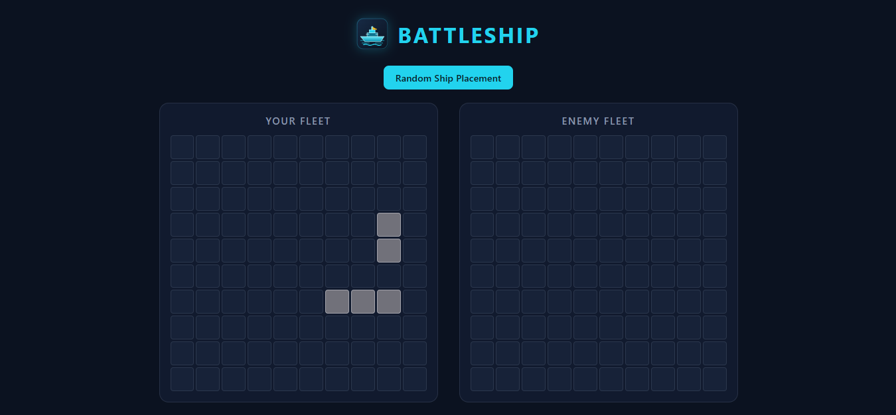
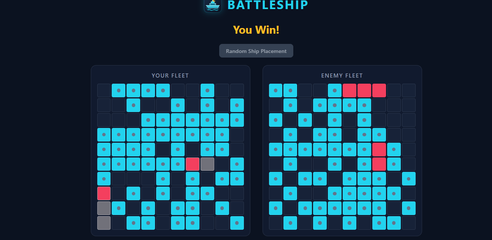

# ⚓ Battleship

A classic Battleship game built with JavaScript, HTML, and CSS. Challenge the computer, plan your attacks, and try to sink all its ships before it sinks yours!

## 🎮 Game Preview




## ✨ Features

- **Player vs Computer:** Play against a computer opponent.
- **Random Ship Placement:** Ships are placed randomly on the game board.
- **Interactive Game Boards:** View your own board and attack the computer's board.
- **Hit and Miss Feedback:** See the results of your attacks on the board.
- **Computer Attacks:** The computer automatically attacks after the player's turn.
- **Unit Tests:** Test the core game logic using Jest.

## 🛠️ Technologies Used

- JavaScript (ES6 Modules)
- HTML5
- CSS3
- Webpack
- Jest
- Git and GitHub

## 🚀 Getting Started

### Prerequisites

Make sure you have [Node.js](https://nodejs.org/) and npm installed on your computer.

### Installation

1. Clone the repository:

   ```bash
   git clone YOUR_REPOSITORY_URL
   ```

2. Navigate to the project folder:

   ```bash
   cd BattleShip
   ```

3. Install the dependencies:

   ```bash
   npm install
   ```

## 🎯 Run the Game

Build the project using Webpack:

```bash
npm run build
```

The generated files will be available in the `dist` directory.

Open `dist/index.html` in your browser or use a local development server to run the game.

## 🧪 Run Tests

Run the unit tests with Jest:

```bash
npm test
```

The tests cover the core game logic, including ships, game boards, and player attacks.

## 🌐 Live Demo

Play the game online: **Coming soon!**

*The live demo link will be added after deployment.*

## 📁 Project Structure

```text
BattleShip/
├── src/
│   ├── assets/
│   │   └── battleship.svg
│   ├── modules/
│   │  